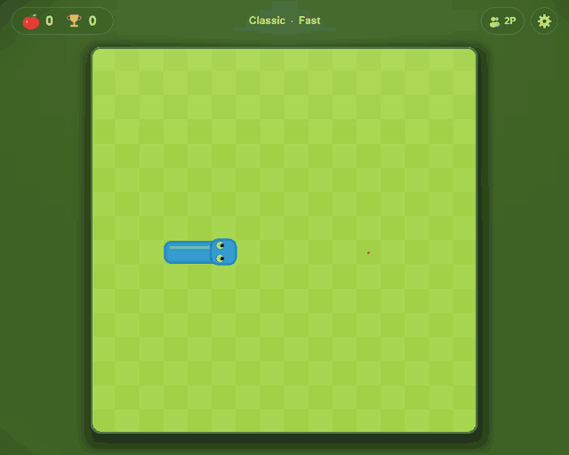

# Snake for Linux

[](https://github.com/Daniel-the-Boehm/Snake-Multiplayer-Linux/releases/latest)
[](https://github.com/Daniel-the-Boehm/Snake-Multiplayer-Linux/releases)




Snake in Python with pygame, packaged as a single program that needs no Python on the PC. It plays alone or with up to four people on the same Wi-Fi, and it is compatible with the [Windows version](https://github.com/Daniel-the-Boehm/Snake-Multiplayer-Windows) and the [macOS version](https://github.com/Daniel-the-Boehm/Snake-Multiplayer-Mac): a Linux PC can host a game that Windows and Mac players join, and the other way round.

## Download

The downloads are on the [latest release](https://github.com/Daniel-the-Boehm/Snake-Multiplayer-Linux/releases/latest). They work on 64-bit Intel and AMD PCs (x86_64).

| Your system | What to do |
| --- | --- |
| Any distribution | Open a terminal, paste the command below and press Enter. |
| Ubuntu, Debian, Linux Mint, Pop!_OS, Zorin | Download `snake-multiplayer_amd64.deb` and double-click it. |
| Without installing | Download `Snake-linux-x86_64.tar.gz`, extract it and double-click `snake-multiplayer`. |

```
curl -fsSL https://raw.githubusercontent.com/Daniel-the-Boehm/Snake-Multiplayer-Linux/main/install.sh | sh
```

The command needs no root. It puts the game into `~/.local/bin` and adds Snake to the application menu. To remove it again:

```
curl -fsSL https://raw.githubusercontent.com/Daniel-the-Boehm/Snake-Multiplayer-Linux/main/uninstall.sh | sh
```

A step-by-step guide in German, including troubleshooting, is in [ANLEITUNG.md](ANLEITUNG.md).

## Features

- Seven game modes
- Local multiplayer for two to four players with automatic discovery on the network
- Four map sizes, four speeds and up to 144 apples on the board at once
- Four colour themes and four snake styles
- Your own pictures as background, snake head or fruit: drag an image into the window
- Settings and high scores are saved between sessions

## Game modes

| Mode | Rule |
| --- | --- |
| Classic | Solid borders. Hit a wall or yourself and the round is over. |
| No Borders | The edges wrap around. |
| Wall | Every apple turns the end of your tail into a permanent wall. |
| Twin | After each apple, head and tail swap and you move the other way. |
| Mirror | Left and right are swapped. |
| Rush | The more you eat, the faster you go. |
| Apple | You play the apple. Alone, a computer-controlled snake hunts you. With friends, they are the snakes and have 60 seconds to catch you. |

## Controls

| Key | Action |
| --- | --- |
| Arrow keys or WASD | Start and steer |
| P | Pause |
| R | Restart, or teleport in Apple mode |
| Esc | Settings |
| M | Multiplayer |
| Space or Enter | Play again |
| F11 | Full screen |
| F3 | Show frame rate |

## Multiplayer

One player hosts, the others join. All devices have to be on the same network; guest networks usually block devices from seeing each other.

The game uses TCP port 55055 for the match and UDP port 55056 to find hosts. If discovery fails, enter the host's IP address by hand in the join screen.

Fedora, openSUSE and other systems with an active firewall block these ports until you open them:

```
sudo firewall-cmd --permanent --add-port=55055/tcp --add-port=55056/udp
sudo firewall-cmd --reload
```

With ufw:

```
sudo ufw allow 55055/tcp
sudo ufw allow 55056/udp
```

## Run from source

Requirements: Python 3.12 or 3.13.

```
python3 -m venv venv
venv/bin/pip install -r requirements.txt
venv/bin/python snake.py
```

## Build the packages

```
./build_linux.sh 1.0.0
```

The script writes `dist/Snake-linux-x86_64.tar.gz` and `dist/snake-multiplayer_amd64.deb`. If [uv](https://docs.astral.sh/uv/) is installed, it builds with a Python that only needs glibc 2.17, so the result runs on practically every distribution of the last ten years. Without uv it uses the system Python, and the result needs at least the glibc version of the PC that built it.

Publishing a release on GitHub starts the workflow in `.github/workflows/build.yml`, which builds both files and attaches them to the release.

## Project layout

| File | Purpose |
| --- | --- |
| `snake.py` | The whole game |
| `build_linux.sh` | Builds the program, the tar.gz and the deb |
| `install.sh`, `uninstall.sh` | Install into and remove from the home folder |
| `packaging/` | PyInstaller spec, menu entry and the note inside the tar.gz |
| `snake.png` | Icon |

## Saved data

Everything is stored in `~/.local/share/snake`:

| File | Content |
| --- | --- |
| `snake_save.json` | Settings and high scores |
| `snake_photos/` | Custom pictures |
| `snake_error.log` | Crash report, if the game stops unexpectedly |
